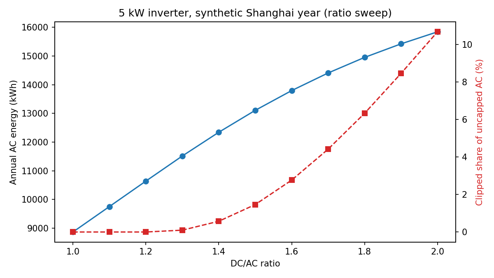
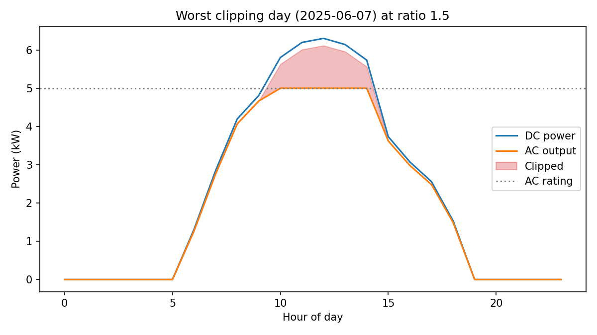

# pvclip

[](tests/)
[](pyproject.toml)
[](LICENSE)

**English** | [简体中文](#pvclip-中文)

**Oversize the array and the inverter throws away the midday peak. Undersize it and you pay for an inverter you never use. `pvclip` finds the ratio that pays — and prices what a DC-coupled battery can win back.**

## Results at a glance

5 kW inverter, one synthetic year (seeded, latitude 31.2°, hourly), illustrative USD costs ($350/kWdc modules + DC BOS, $120/kWac inverter, $0.12/kWh, 5% discount, 25 years):



| DC/AC ratio | AC energy (kWh/yr) | clipped share | clipping hours | LCOE ($/kWh) | NPV ($) |
|---|---|---|---|---|---|
| 1.0 | 8,867 | 0.0% | 0 | 0.0244 | 11,392 |
| 1.3 | 11,515 | 0.1% | 78 | 0.0233 | 14,971 |
| 1.5 | 13,106 | 1.5% | 422 | **0.0231** | 17,074 |
| 1.8 | 14,951 | 6.3% | 1,171 | 0.0237 | 19,357 |
| 2.0 | 15,842 | 10.7% | 1,598 | 0.0245 | 20,332 |

Three findings worth a designer's attention:

1. **Energy rises, but every extra kWp adds less.** From 1.0 to 1.5 the array grows 50% and energy grows 48%; from 1.5 to 2.0 it grows 33% more and energy only 21%. The clipped share, meanwhile, grows faster than linearly — 1.5% at 1.5, 10.7% at 2.0.
2. **The LCOE optimum (1.5 here) is not the NPV optimum (2.0, still rising at the edge of the sweep).** Which ratio "wins" depends on the objective and on prices — the literature finds optima anywhere from ~1.2 to ~1.9 for the same reason. Run the sweep on your series and your costs; do not copy a rule of thumb.
3. **Clipped energy is concentrated and therefore recoverable.** At ratio 1.5, 200 kWh/yr of DC power is refused, almost all of it in summer middays. A 3 kWh DC-coupled battery recovers 172 kWh of it (86%); the ceiling is the 90% round-trip efficiency, reached at 5 kWh. Sizing the battery to the *clipping* stream, not to the load, is a much smaller battery than a whole-home backup.


*The worst clipping day (7 June) at ratio 1.5: the AC output sits flat at the 5 kW rating for five hours while the array could have delivered up to 6.3 kW.*

## Problem

Oversizing the DC array relative to the inverter — a DC/AC ratio (also called inverter loading ratio, ILR) above 1 — is standard practice: panels rarely reach nameplate power, so extra DC capacity lifts shoulder-hour output for less money than a bigger inverter. The price is *clipping*: whenever the array's DC output would push the inverter past its AC rating, the inverter holds its output at the rating and the excess is discarded.

The sizing literature agrees on the shape of the trade-off and disagrees on the number. A Valencia residential study varying ratio, azimuth and slope in SAM found energy-and-payback optima at ratios of 1.63–1.87 for that site and tariff. A deterministic ILR method for utility-scale plants (University College Cork team, *Energy Reports*, 2025) stresses that no universal optimum exists — the answer moves with geography, climate and economics. A physics-informed PVsyst study of a 10 MWp Mediterranean plant found the optimum at 1.35–1.40, with clipping growing nonlinearly past it and concentrated in summer middays. Bifacial measurements show the same mechanism amplified: rear-side gain raises DC power and clipping with it, yet the project economics can still improve because the extra energy outweighs the clipped share.

What is missing is a packaged, tested, dependency-light tool that turns this into a one-command workflow on *your* time series: clipping accounting with a stated energy identity, a ratio sweep with LCOE/NPV optima, orientation mixes, a DC-coupled capture sizing, and a check of how much the time resolution of your data is hiding. SAM and PVsyst do the simulation inside black boxes; `pvclip` is the transparent version — numpy and pandas only, every number reproducible from the code.

## Method

**Clipping** (`pvclip/clipping.py`). For each timestep, `ac_uncapped = dc × η`, `ac = min(ac_uncapped, Pac)`, and the clipping loss is `ac_uncapped − ac` at the AC meter. The refused DC power is `dc_excess = dc − ac/η`, so the identity `clipped_ac = η × dc_excess` holds exactly at every step (pinned by a test). Capping AC output at the rating follows the Sandia grid-connected inverter model as implemented in pvlib's `snlinverter`, which clips modelled output at `Pac0`. Efficiency is a user-supplied curve — constant, a quadratic partial-load shape, or any callable digitised from a datasheet.

**Array DC power** (`pvclip/array.py`). The standard linear form used across the clipping literature: `P = P_stc × (G/1000) × (1 + γ(T_cell − 25)) × (1 − losses)`, with cell temperature from the NOCT model when only ambient temperature is known. Mixed-orientation arrays are supported by capacity-weighted sub-arrays; east/west splits flatten the midday peak and clip less at the same ratio.

**Weather** (`pvclip/weather.py`). A seeded synthetic year (clear-sky bell curve, day length from latitude, seeded cloud variability) so every example runs offline and reproducibly. For real sites, load your own POA/temperature CSV, or use the optional pvlib clear-sky helper (proper solar position and transposition; pvlib is an optional extra, never required).

**Economics** (`pvclip/economics.py`). CAPEX split into DC and AC parts, discounted O&M, geometric annual degradation, LCOE and NPV over the system lifetime, discounted payback. Costs are generic currency units; the example's USD figures are stated, illustrative assumptions.

**Clipped-energy capture** (`pvclip/capture.py`). A causal greedy rule: the battery charges only from refused DC power and discharges whenever nothing is being refused. No foresight, no optimiser — an achievable lower bound for a DC-coupled retrofit. Round-trip efficiency is split symmetrically between charge and discharge, and state of charge is kept within bounds by construction.

**Resolution bias** (`pvclip/sweep.py`). Block-averaging a fine DC series to coarser steps and re-measuring clipping. Hourly data smooths away the peaks that cause clipping, so it understates the loss versus 5-minute data. On the smooth synthetic series here the gap is small (15-minute → hourly understates the clipped share by 2.2% relative); on real cloud-edge data it is larger — measure it on your series before trusting an hourly model.

## Quickstart

```bash
pip install -e ".[plot]"
python examples/quickstart.py
```

```python
import numpy as np
from pvclip import (
    Economics, capture_sweep, clip_series, dc_power,
    sweep_ratios, synthetic_year,
)

weather = synthetic_year(days=365, seed=42)          # POA + temperature
dc_per_kwp = dc_power(weather["poa_wm2"], weather["temp_c"], pdc_kw=1.0)
table = sweep_ratios(dc_per_kwp, [1.0, 1.3, 1.5, 1.8, 2.0],
                     pac_kw=5.0, econ=Economics())
print(table[["ratio", "ac_energy_kwh", "clipped_fraction", "lcoe", "npv"]])

res = clip_series(dc_per_kwp * 7.5, ac_rating_kw=5.0)  # ratio 1.5
print(res.metrics)  # clipped_kwh, hours_clipped, capacity_factor, ...
cap = capture_sweep(res.dc_excess_kw, [1.0, 3.0, 5.0, 8.0],
                    battery_kw=5.0, rte=0.90)
print(cap)
```

Bring your own data:

```python
from pvclip import load_series_csv
weather, dt_h = load_series_csv("site.csv")  # columns: time, poa_wm2, temp_c
```

## API

| Function | What it does |
|---|---|
| `clip_series(dc_kw, ac_rating_kw, dt_h, efficiency, dc_rated_kw)` | Cap a DC series; returns per-step AC, clipped and refused power + metrics |
| `efficiency_constant(eta)` / `efficiency_quadratic(...)` | Built-in efficiency curves; any `eta(load)` callable also works |
| `dc_power(poa, temp_amb, pdc_kw, ...)` / `dc_power_from_cell_temp(...)` | Array DC power, ambient- or cell-temperature form |
| `dc_power_mix(poa_by_orientation, shares, ...)` | Mixed-orientation array DC power |
| `cell_temperature(poa, temp_amb, noct)` | NOCT cell-temperature estimate |
| `synthetic_year(days, dt_h, latitude, azimuth_deg, ...)` | Seeded synthetic POA/temperature DataFrame |
| `load_series_csv(path, ...)` | Load a user POA/temperature CSV → `(df, dt_h)` |
| `pvlib_clearsky(...)` | Optional pvlib clear-sky POA + cell temperature (needs pvlib) |
| `Economics(...)` / `lcoe / npv / payback_years / evaluate` | Discounted techno-economics for a sizing candidate |
| `sweep_ratios(dc_per_kwp, ratios, pac_kw, ...)` | Ratio sweep table with energy, clipping and economics |
| `optimum(table, criterion="lcoe" \| "npv")` | Best row of a sweep table |
| `resolution_bias(dc_kw, ac_rating_kw, dt_h, factors)` | Clipping measured at coarser time resolutions |
| `capture_clipped(dc_excess_kw, battery_kwh, battery_kw, rte, ...)` | Greedy DC-coupled capture simulation |
| `capture_sweep(...)` / `battery_for_capture(...)` | Recovered energy vs battery size; smallest size hitting a target |

## Honesty notes — read before deciding anything

- **Synthetic weather is not a site.** The example's 1,773 kWh/kWp specific yield at ratio 1.0 is optimistic versus a real Shanghai rooftop; the seeded bell curve has mild, smooth clouds. The sweep's *shape* and the optimum's *sensitivity* are the point, not the absolute kWh. Bring measured or TMY data for a real decision.
- **Costs in the example are illustrative**, not quotes. The LCOE/NPV levels move with them; the ratio ranking moves less, but check it with your prices — the NPV optimum sitting at the sweep edge (2.0) is a warning to extend the sweep, not a recommendation to build at 2.0.
- **Efficiency curves are stand-ins.** The quadratic shape is illustrative, not a fitted datasheet curve. For a real inverter, pass a curve digitised from its datasheet or a fitted Sandia/CEC parameter set.
- **Not modelled:** MPPT voltage/current windows, night tare (standby) consumption, inverter degradation or replacement, battery ageing and cycle limits, export limits, reactive power, and soiling/snow beyond the flat `losses` factor. The capture rule ignores load and tariffs — it maximises recovered clipped energy, not bill savings.
- **Resolution bias measured here is a lower bound.** Smooth synthetic data barely spikes; real 1-minute cloud-edge ramps clip harder and are hidden more by hourly averaging.

## Tests

```bash
pip install -e ".[test,plot]"
pytest -q          # 52 passed, 1 skipped (pvlib clear-sky test, pvlib optional)
```

The tests pin the energy identity (`clipped = η × refused` at every step), the STC identity, SOC bounds, monotonic sweep behaviour, and the resolution-bias direction on a constructed spiky series.

## References

- Kaewnukultorn, T., Sepúlveda-Mora, S. B., Purnell, R., & Hegedus, S. "Electrical and Financial Impacts of Inverter Clipping on Oversized Bifacial Photovoltaic Systems." *Energies* 2024, 17(22), 5658. https://www.mdpi.com/1996-1073/17/22/5658/htm
- "Methodology to Estimate the Impact of the DC to AC Power Ratio, Azimuth, and Slope on Clipping Losses of Solar Photovoltaic Inverters." *Sustainability* 2023, 15(3), 2797. https://www.mdpi.com/2071-1050/15/3/2797/xml
- "A refined method for optimizing inverter loading ratio in utility-scale photovoltaic power plant." *Energy Reports*, 2025 (University College Cork). https://www.pv-magazine.com/2025/01/23/improving-pv-plant-performance-via-optimized-inverter-loading-ratio/
- Türkoğlu, O., & Arucu, M. "Thermo–Clipping Interactions in Utility-Scale PV Systems: Integrating Thermal–Optical Dynamics for Optimal DC/AC Sizing." *Applied Sciences* 2026, 16, 5562. https://doi.org/10.3390/app16115562
- Good, J., & Johnson, J. X. "Impact of inverter loading ratio on solar photovoltaic system performance." *Applied Energy* 2016, 177, 475–486.
- Deschamps, E. M., & Rüther, R. "Optimization of inverter loading ratio for grid connected photovoltaic systems." *Solar Energy* 2019, 179, 106–118.
- King, D. L., Boyson, W. E., & Kratochvil, J. A. *Photovoltaic Array Performance Model.* Sandia National Laboratories, SAND2004-3535 (2004); inverter model SAND2007-5036 (2007) — the clipping-at-`Pac0` convention pvlib implements.

## License

BSD-3-Clause. See [LICENSE](LICENSE).

---

## pvclip 中文

**English** | **简体中文**

**组串多配、逆变器中午就把多余的功率扔掉；组串配少了，逆变器又一直吃不饱。`pvclip` 算出哪个容配比真正赚钱，并算出直流耦合储能能抢回多少被削掉的电。**

### 一眼结果

5 kW 逆变器、一年合成气象（种子固定、北纬 31.2°、小时分辨率）、示意美元成本（组件+直流侧 $350/kWdc、逆变器 $120/kWac、电价 $0.12/kWh、折现率 5%、25 年）：

| 容配比 | 年交流电量 (kWh) | 削峰占比 | 削峰小时数 | LCOE ($/kWh) | NPV ($) |
|---|---|---|---|---|---|
| 1.0 | 8,867 | 0.0% | 0 | 0.0244 | 11,392 |
| 1.3 | 11,515 | 0.1% | 78 | 0.0233 | 14,971 |
| 1.5 | 13,106 | 1.5% | 422 | **0.0231** | 17,074 |
| 1.8 | 14,951 | 6.3% | 1,171 | 0.0237 | 19,357 |
| 2.0 | 15,842 | 10.7% | 1,598 | 0.0245 | 20,332 |

三点结论：① 能量随容配比递增但边际递减，削峰占比却超线性爬升（1.5 倍时 1.5%、2.0 倍时 10.7%）；② LCOE 最优（1.5）与 NPV 最优（2.0，仍在扫描边界上爬升）不是同一个答案——最优比值随目标和价格走，文献里 1.2–1.9 都有，必须用自己的序列和成本重扫，不要抄经验值；③ 被削的电高度集中在夏季正午，因而可回收：1.5 倍时一年被拒 200 kWh 直流电，3 kWh 直流耦合电池可抢回 172 kWh（86%），上限是 90% 往返效率（5 kWh 时达到）。按削峰流来配电池，比按整屋备电配要小得多。

### 方法

**削峰**：每步 `ac_uncapped = dc × η`，`ac = min(ac_uncapped, Pac)`，削峰损失记在交流侧；被拒直流功率 `dc_excess = dc − ac/η`，恒等式 `clipped = η × dc_excess` 逐时成立（有测试锁定）。交流封顶遵循 Sandia 并网逆变器模型在 pvlib `snlinverter` 中的做法（输出削峰于额定值 `Pac0`）。效率曲线可自定义（常数、二次部分负载形状，或从数据手册数字化的任意函数）。

**直流功率**：文献通用线性形式 `P = P_stc × (G/1000) × (1 + γ(T_cell − 25)) × (1 − losses)`，只有环境温度时用 NOCT 模型估算电池温度；支持多朝向按容量加权（东西分朝摊平正午峰值、同容配比下削峰更少）。

**气象**：种子固定的合成年（晴空钟形曲线+纬度日长+种子云扰动），离线可复现；真实项目请用自己的 POA/温度 CSV（`load_series_csv`），或用可选的 pvlib 晴空路径（pvlib 为可选依赖）。

**经济性**：直流/交流分开计 CAPEX、折现运维、逐年几何衰减，算 LCOE、NPV 与折现回收期。货币为通用单位，示例美元数字为明示的示意假设。

**削峰回收**：因果贪心规则——电池只充被拒的直流电、无被拒功率时放电，无预见、无优化器，是直流耦合改造可达到的下界；往返效率在充放电两侧对称分摊，SOC 恒在界内。

**分辨率偏差**：把细粒度直流序列块平均到粗粒度再测削峰。小时数据会抹平造成削峰的尖峰，从而低估损失；本例平滑合成数据上 15 分钟→小时低估 2.2%（相对值），真实云边尖峰数据下偏差更大——信任小时模型前先在自己的序列上测。

### 快速开始

```bash
pip install -e ".[plot]"
python examples/quickstart.py
```

```python
from pvclip import Economics, sweep_ratios, dc_power, synthetic_year

weather = synthetic_year(days=365, seed=42)
dc_per_kwp = dc_power(weather["poa_wm2"], weather["temp_c"], pdc_kw=1.0)
table = sweep_ratios(dc_per_kwp, [1.0, 1.3, 1.5, 1.8, 2.0],
                     pac_kw=5.0, econ=Economics())
```

### 诚实说明（做决定前必读）

- **合成气象不是实测。** 示例 1,773 kWh/kWp 的比发电量偏乐观（云扰动温和而平滑）；看的是扫描曲线的形状与最优点的敏感性，不是绝对电量。真实决策请用实测或 TMY 数据。
- **示例成本是示意值，不是报价。** LCOE/NPV 的绝对值随成本走；NPV 最优落在扫描边界（2.0）是"把扫描范围扩大"的警告，不是"按 2.0 建"的建议。
- **效率曲线是示意形状**，不是拟合的数据手册曲线；真实逆变器请传入数字化曲线。
- **未建模：** MPPT 电压/电流窗口、夜间待机损耗、逆变器衰减与更换、电池老化与循环限制、出口限额、无功、以及平铺 `losses` 之外的积灰/积雪。回收规则不考虑负荷与电价——它最大化抢回的削峰能量，不是电费节省。

### 测试

```bash
pip install -e ".[test,plot]"
pytest -q          # 52 passed, 1 skipped（pvlib 晴空测试，pvlib 为可选依赖）
```

许可证：BSD-3-Clause，见 [LICENSE](LICENSE)。
